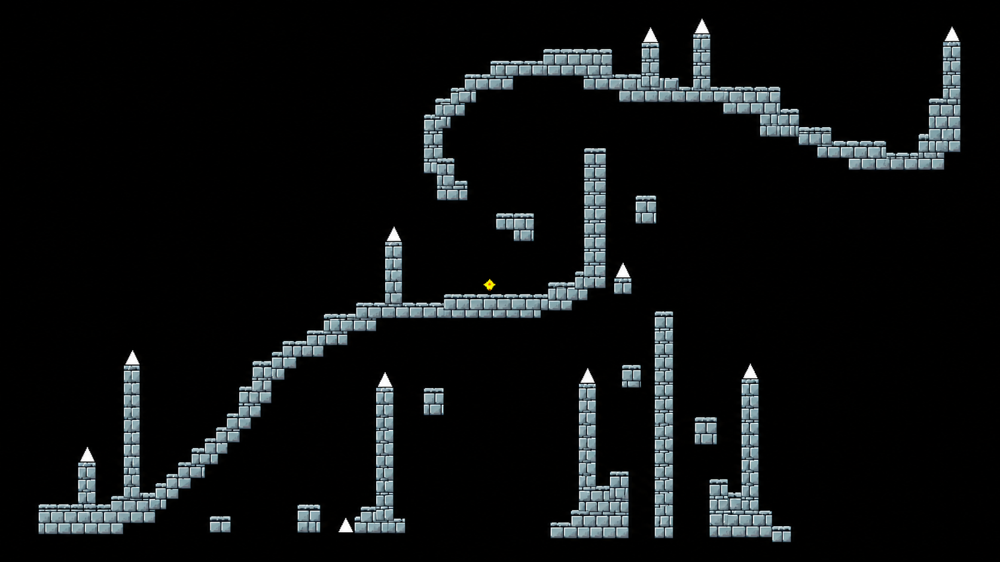

# 카메라 튜토리얼

Unity 2D 게임을 플레이하며 카메라 촬영부터 화면 출력, 굴곡 효과, 플레이어 레이어 분리까지 배우는 실습형 프로젝트입니다.

## 개발 환경

- Unity 6000.5.1f1
- C#, Universal Render Pipeline (URP)
- Input System, Tilemap, 2D Physics, RenderTexture, 커스텀 Shader

## 실행 방법

1. 저장소를 내려받고 Unity Hub에서 프로젝트 폴더를 추가합니다.
2. Unity 6000.5.1f1로 열고 패키지 설치와 에셋 임포트가 끝날 때까지 기다립니다.
3. `Tools > Camera Tutorial > 1. Create or Open Tutorial`을 선택합니다.
4. `CameraTutorial_Working` 씬에서 Play를 누릅니다.

## 학습 순서

| 단계 | 내용 | 실습 목표 |
| --- | --- | --- |
| 1 | Tilemap 직접 꾸미기 | 빈 공간에 Rock 타일 5개 배치 |
| 2 | Main Camera 이해하기 | W로 설명서를 열고 마지막 페이지까지 읽기 |
| 3 | RenderTexture 연결하기 | RT 플레이어를 OUTPUT Texture 문으로 이동 |
| 4 | 최종 출력 카메라 완성 | T로 OX 퀴즈 시작, 5문제 중 3문제 이상 정답 |
| 5 | 굴곡 Shader 이해하기 | Vertical / Horizontal Curve 슬라이더 조절 |
| 6 | 플레이어 화면 복구 | I로 굴곡된 플레이어와 Overlay로 분리한 플레이어 비교 |
| 7 | 카메라 구조 정리 | W로 전체 실행 순서 설명서 확인 |
| 8 | 최종 플레이 테스트 | 이동, 점프, 충돌, 카메라 추적 확인 후 Enter |

## 조작

- A/D 또는 방향키: 이동
- Z: 점프 (2단 점프)
- R: 시작점 복귀
- 숫자 1~8: 학습 단계 이동
- W: 설명서
- Q: 안내 UI 숨기기

## 프로젝트 구성

- `Assets/Script`: 플레이어, 카메라, 튜토리얼 및 실시간 편집 기능
- `Assets/Shader`: 화면 굴곡 셰이더
- `Assets/Editor`: 튜토리얼 생성, 체크포인트 및 편집 도구
- `Assets/CameraTutorial`: 단계별 실습 자료
- `Assets/Scenes`: 게임 씬
- `CameraTutorialGuide`: 학습 가이드
- `Packages`, `ProjectSettings`: Unity 패키지 및 프로젝트 설정

체크포인트 저장·복원은 `Tools > Camera Tutorial` 메뉴에서 사용할 수 있습니다.

Unity 캐시, 로컬 설정 및 빌드 결과물은 저장소에서 제외합니다. 포함된 외부 에셋과 폰트의 이용 조건은 해당 에셋의 라이선스 문서를 확인하세요.
